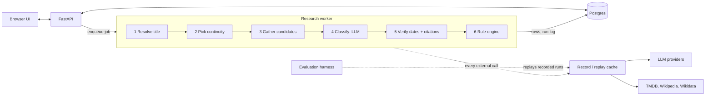

# Canon & Order

> Spoiler-free, release-ordered timelines of **everything official** in a screen universe:
> films, seasons, specials, shorts, webisodes, home-release extras and in-universe promos,
> with a source for every entry.

**Status:** week 1 of 6. Domain model, gold-set schema and tooling are in; the pipeline,
API and live demo are coming ([plan](docs/PRD.md#roadmap)).

This is an independent personal project.

## The Problem

"What order do I watch this in?" guides are hand-curated for a few big franchises, mostly
list films only, and rarely say where a date came from. The shorts, webisodes and promos
that completionists care about are the hardest part to find and date, and they are exactly
what generic lists leave out.

Canon & Order takes a title and a year, finds every official screen release in its
continuity, and builds the timeline in release order under explicit rules: which continuity
counts, how crossovers and semi-canon entries are treated, how partial dates sort, how a
season is split around a film released mid-run, and how promos attach to the season they
were made for.

## How it Works (Planned)



**Design principle:** the LLM makes judgment calls (is this short canon? which season was
this promo made for?); deterministic, unit-tested code owns dates, rows, splits and order.
See [ADR 0001](docs/adr/0001-llm-for-judgment-code-for-rules.md).

## Evaluation (Planned)

A hand-verified gold set (12 universes for v1, split into dev and test) scores the hybrid
pipeline against LLM-only baselines on entry precision and recall, date accuracy, order
(Kendall tau), rule compliance, citation support, invented entries, cost and latency.
The protocol is in [docs/evaluation.md](docs/evaluation.md); results will be tabled here.

## Development

Requires [uv](https://docs.astral.sh/uv/).

```bash
uv sync                                   # create .venv and install dependencies
uv run pre-commit install                 # lint, types and gold checks on every commit
uv run pytest                             # tests
uv run python -m canon_and_order.gold validate   # validate the gold set
```

## Repository Layout

```text
src/canon_and_order/
  domain/     PartialDate, Work, Piece, Row and friends
  eval/       evaluation metrics (in progress: titles, matching, predictions)
  gold/       gold-file schema, loader and validation CLI
  rules/      rule engine: works in, ordered timeline rows out (splits, companions, sorting)
gold/         annotation guide, template, gold universes, changelog
docs/         PRD, evaluation protocol, architecture decision records
tests/
```

## Data and Attribution

- This product uses the TMDB API but is not endorsed or certified by TMDB (planned data source).
- Wikipedia and Wikidata content is used under CC BY-SA 4.0 and CC0 respectively.
- The gold set in `gold/` is licensed CC BY-SA 4.0: see [DATA_LICENSE.md](DATA_LICENSE.md).

## License

Code: [MIT](LICENSE). Gold-set data: [CC BY-SA 4.0](DATA_LICENSE.md).
